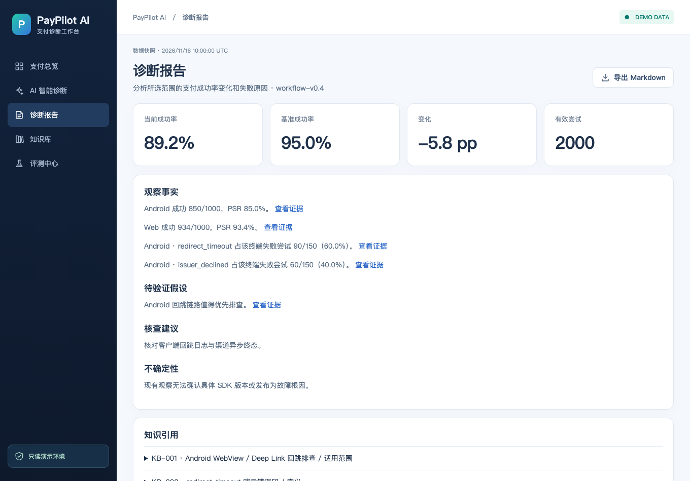

# PayPilot AI · 跨境支付诊断工作台

面向跨境支付运营与分析人员的本地只读演示。选择德国、Klarna、最近 24 小时，点击「开始 AI 诊断」，即可从成功率变化追查到终端、失败分母和知识来源，决定下一步核查什么。演示使用合成交易，用户耗时收益待实测。

[60 秒演示脚本](portfolio/demo-script.md) · [产品案例](portfolio/PayPilot-AI.html) · [20 题冻结对照](evaluation/reports/real-model-v1.md) · [时间范围复测](evaluation/reports/period-v1.md) · [场景与 MVP 取舍](docs/product-opportunity.md)

新增 40 道冻结题，规则通过 29 道，DeepSeek 通过 31 道。4 个脚本化浏览器会话完成了 20 项试用任务，其中 19 项达标。两种已知根因的注入与修复在 3 千、3 万、30 万笔交易上共运行了 180 次诊断。[逐项结果与复现命令](evaluation/reports/field-study-v2.md)



## 一条命令启动完整演示

在项目根目录运行：

```sh
./start.sh
```

看到“PayPilot 已启动”后打开[支付总览](http://127.0.0.1:5173/dashboard)。已有本地演示数据库、Python 虚拟环境和前端依赖的工作区会直接启动本地服务；按 Ctrl+C 停止脚本启动的前后端，PostgreSQL 可继续复用。全新检出使用 Docker Compose，需要先启动 Docker，首次构建需联网。容器在后台运行，用 `docker compose -f infra/compose.yaml --profile demo stop` 停止。

## 本地开发启动

需要 Python 3.11、Node.js 22.12+ 或 24+、npm 和 Docker Compose。以下命令在仓库根目录执行。数据库绑定本机 55432 端口，API 和前端分别使用 8000 与 5173。首次运行需要联网安装锁定依赖。

```sh
docker compose -f infra/compose.yaml up -d --wait
python3.11 -m venv .venv
. .venv/bin/activate
python -m pip install -r backend/requirements.lock
alembic -c backend/alembic.ini upgrade head
python scripts/seed_payments.py
pytest -q tests/week01
./scripts/start_api.sh
```

另一个终端启动前端。

```sh
npm ci --prefix frontend
npm --prefix frontend run dev
```

访问 [支付总览](http://127.0.0.1:5173/dashboard) 或 [API 文档](http://127.0.0.1:8000/docs)。Vite 将同源的 /api 请求转发给 FastAPI。原型仍可通过 docs 下的原始 HTML 查看。

### 本次工作区的数据库

本机验收使用 PostgreSQL 16.2，数据库目录是被忽略的 .local/pgdata，端口、角色、库名与 Compose 相同。当前机器重启后可以复用已有数据库，跳过 Docker 初始化。

```sh
.venv/lib/python3.11/site-packages/pgserver/pginstall/bin/pg_ctl -D .local/pgdata -l .local/postgres.log -o '-h 127.0.0.1 -p 55432 -k /tmp' -w start
```

切换到 Compose 环境前，可使用同一 pg_ctl 的 `-D .local/pgdata -m fast -w stop` 停止本机实例。Docker 使用独立命名卷，首次启动需迁移和造数。数据库初始化使用本地演示密码。每个库只运行一个 API/执行器进程；离线测试和评测使用独立库，或在 API 停止时执行。

## 运行模式

默认使用 demo-rules-v1，离线解析中英文地区、支付方式、终端、周期与有限的任务类型。所有支付数字均来自 PostgreSQL。外部模型协议支持 chat/completions、JSON 输出、一次修复及可用的 token 用量记录。模型可解析查询并从受控建议中选择核查动作。最终统计与引用由服务端装配和校验。

### DeepSeek 官方 API

本地开发由 `./scripts/start_api.sh` 加载仓库根目录的私有 `.env`。将 `LLM_PROVIDER=deepseek` 写入该文件，并在后端环境中设置 `DEEPSEEK_API_KEY`，然后启动或重启 API。默认模型为 `deepseek-flash`，可通过 `LLM_MODEL_ID` 指定其他受支持的模型。仅服务端向 DeepSeek 官方接口发送演示问题、筛选范围和建议所需的证据摘要。DeepSeek 返回结构化 JSON，服务端校验后保存报告与 token 用量。新任务会显示使用的模型，/api/health 提供 llm_provider 与 model_id。[DeepSeek 官方接入文档](https://api-docs.deepseek.com/zh-cn/)

Docker 使用 `docker compose --env-file .env -f infra/compose.yaml --profile demo up -d --build` 加载同一配置。离线回归与历史评测使用 `LLM_PROVIDER=rules`。其他兼容服务可配置 `LLM_PROVIDER=compatible`、`LLM_BASE_URL`、`LLM_MODEL_ID` 和 `LLM_API_KEY`。

默认身份是本机固定演示分析师。可在服务端设置 DEMO_IDENTITIES，按令牌配置 owner 和角色，例如 `{"local-example":{"owner":"analyst-b","role":"ANALYST"}}`，用 Authorization Bearer 访问。服务端按 owner 授权任务、报告与反馈。种子导入和知识初始化使用迁移账户；分析接口与工具只有只读权限。

## 验证与复现

```sh
. .venv/bin/activate
pytest -q
ruff check backend tests evaluation scripts
ruff format --check backend tests evaluation scripts
npm --prefix frontend run build
# E2E 需要本机 Chrome、前端及 API 在运行
npm --prefix frontend run test:e2e
```

评测入口使用实际 ASGI 应用、自研 Runtime 和 PostgreSQL。将三个数据库 URL 指向独立评测库，先执行同一套迁移与造数。账户角色是集群级，现有集群中的新库可复用。默认评分器按独立 SQL 核对每个可判定指标。以下命令写入 evaluation/results。

```sh
PAYPILOT_RANKER=v0.3 python evaluation/runner.py --split dev
python evaluation/runner.py --split dev
python evaluation/runner.py --split holdout
```

evaluation/datasets 内已保存种子固定的 100 例及分层切分。对外验证结论与待办见 [验收记录](evaluation/reports/acceptance.md)。评测中心读取实际结果文件。人工研究方案与记录状态见 [对照实验](research/protocol.md)。

## 工程入口

| 入口 | 内容 |
|---|---|
| [指标口径](docs/metrics-definition.md)、[黄金样本](docs/golden-scenarios.md) | 窗口、分母和独立 SQL 金标 |
| [架构与接口](docs/agent-architecture.md)、[工具契约](docs/tool-contract.md) | 运行状态、实时事件和只读工具 |
| [数据字典](docs/data-dictionary.md)、[报告 Schema](docs/report-schema.md) | 审计、证据归属、引用和可追溯性 |
| [作品集](portfolio/PayPilot-AI.html)、[三分钟演示脚本](portfolio/demo-script.md) | 本地可打开、打印的十页案例及演示路径 |

种子批次与内容哈希在 data/seed_manifest.json。默认重复运行保留现有批次。显式重建需同时指定 --reset --confirm-demo-reset，仅重建此固定 DEMO 数据批次。Docker 停止命令为 `docker compose -f infra/compose.yaml stop`。
